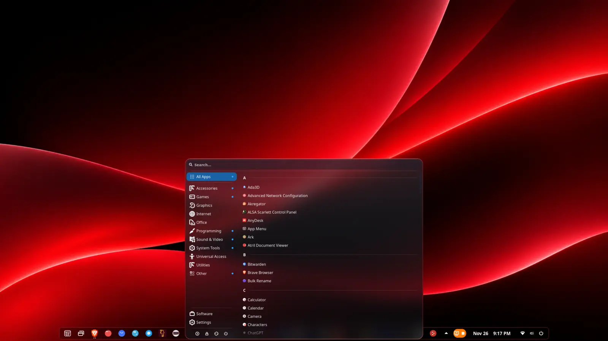

# Crimson Glass

Crimson Glass is the Debian desktop I use on my own PC. I built it around a dark GNOME desktop with a red glass dock, a searchable Start menu, and an animated cursor. This repo packages the look and the everyday tweaks behind it, from opening Windows executables in Files to keeping my Bluetooth headphones in stereo.



## Install on Debian

The full setup targets **Debian 13, GNOME 48, and amd64**. Open a terminal in GNOME and run these commands from the checkout:

```sh
sh ./setup.sh --dry-run
sh ./setup.sh
```

The full setup applies the desktop profile, installs feature dependencies, enables compressed swap to reduce disk I/O under memory pressure, and configures the available boot, graphics, storage, and device integrations. It can prompt for sudo and package confirmation. Sign out and back in to load the desktop changes, then reboot for GRUB and driver changes. The installer backs up replaced user files and GNOME settings under `~/.local/state/crimson-glass/backups/`.

For the GNOME desktop and its package dependencies, run `sh ./install.sh --packages`. Add `--apps` if you also want Bitwarden and Parsec. See the [feature and install reference](docs/inventory.md) for the individual flags and their effects.

The bundled Crimson Pulse cursor works with Adwaita application icons. For the red icons in the screenshot, install the red variant of [Tela Circle](https://github.com/vinceliuice/Tela-circle-icon-theme) before running setup.

## Gaming performance

The full installer includes a game launcher that holds the system performance profile for the game and releases it on exit. In Steam, add this under **Properties → Launch Options** for the game:

```sh
~/.local/bin/crimson-game %command%
```

For standalone Windows games, choose **Open With → Proton (Gaming)** in Files. On a desktop-only install, add `--gaming` to install power profile support. A performance profile helps only if the game responds to the changed power settings. For a game limited by the GPU, try the game’s own upscaler in Quality mode. If [Gamescope](https://github.com/ValveSoftware/gamescope) is installed, the launcher can also render at a lower resolution and upscale it to the display:

```sh
~/.local/bin/crimson-game --upscale 1920x1080 2560x1440 -- %command%
```

This is an optional trade-off between rendering cost and image detail. The standard launcher keeps the game’s resolution and HDR behavior.

## My setup

I use Crimson Glass on a desktop that dual boots Debian and Windows. My setup uses two monitors, including an HDR display, a shared NTFS drive, a USB audio interface, Bluetooth headphones, and a cooler with an LCD.

On this PC, the full setup restores my HDR calibration, performance overlay settings, lighting layout, and cooler display preset from `local/`. It matches the connected displays, motherboard, and cooler before applying those settings. I also keep my Terlox installer there so Files can open folders in my terminal.

Git ignores `local/`, so a public clone gets the portable configuration and uses GNOME Terminal when Terlox is unavailable. If you use the repo to back up your own setup, keep a separate copy of your `local/` directory.

## Update and customize

Run `sh ./update.sh --all` to reapply the full setup. If the branch tracks a remote, the script pulls with fast-forward only before installing. For a smaller install, pass the same flags you originally used.

GNOME settings live in `config/`, files installed to the home directory and system live in `payload/`, and the installer lives in `scripts/`. To try the file install in a scratch directory, run `sh ./install.sh --stage "$(mktemp -d)"`.
